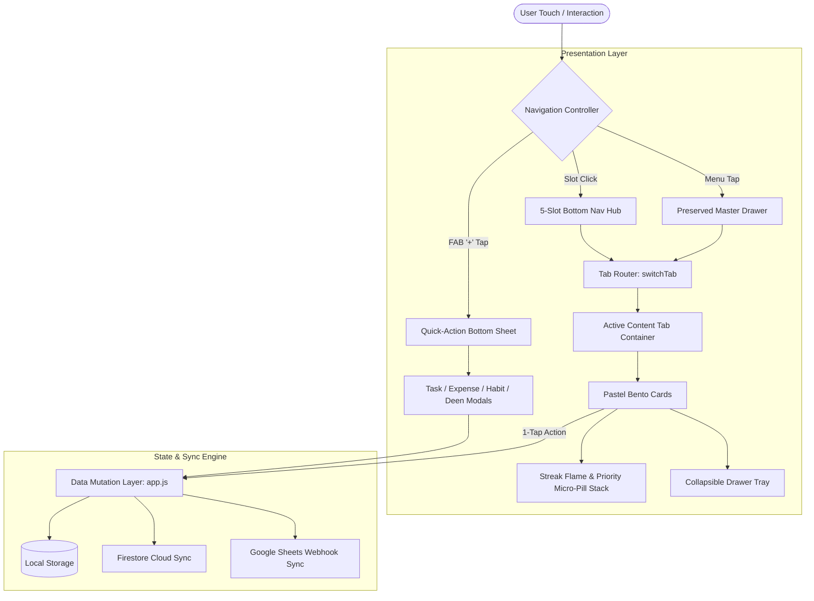
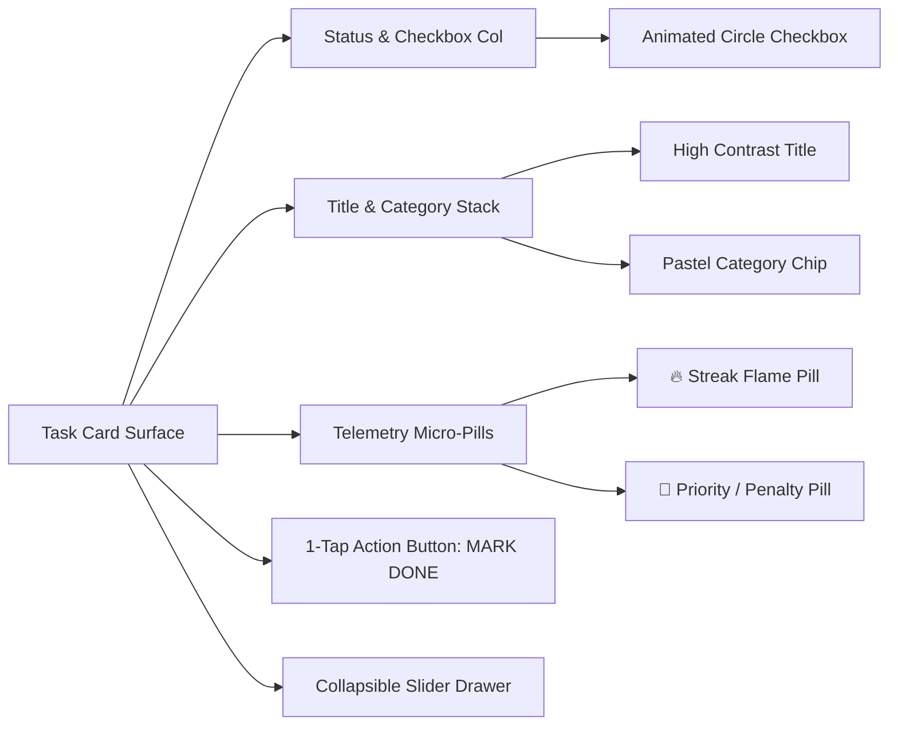

# Dual-Theme Pastel Card System & Floating Hub Navigation

* **Author:** safmuzammil
* **Status:** Draft
* **Date:** 2026-11-11

--------------------------------------------------------------------------------

## Overview

Hisab Tracker is an offline-capable, cloud-synchronized progressive web application serving as a personal life, habit, Islamic deen, and financial operating system. This technical design establishes a comprehensive visual and architectural overhaul, replacing the existing dark neon/obsidian theme and hidden navigation with a modern dual-theme pastel card design system. 

The architecture introduces two flagship themes (*Pastel Morning* and *Pastel Twilight*), restores high-frequency thumb navigation via an ergonomic 5-slot bottom bar centered around a floating circular quick-action trigger (`+`), preserves the full slide-out navigation drawer for secondary and deep modules, repurposes visual avatar clusters into single-user streak and urgency pills, and maintains high information density via collapsible cards.

## The Problem

1. **Monotone Dark Surfaces & Glare**: The app currently supports only dark neon (`classic`), obsidian glass (`obsidian`), and amber (`ramadan`) themes. Users tracking daytime activities in outdoor sunlight suffer from severe legibility and contrast issues.
2. **High Interaction Friction**: The bottom navigation bar is currently suppressed via CSS (`nav, .bottom-nav { display: none !important; }`), forcing all routine interactions into a multi-tap drawer or dashboard launcher flow. 80% of daily actions (logging an expense, checking off a daily prayer, or completing a task) require unnecessary taps.
3. **Card Clutter vs Glanceable Momentum**: Existing task cards carry extensive metadata (7-day mini-week pills, penalty rates, custom inputs, notes) in a flat list without glanceable visual momentum indicators (active streaks, urgency badges, priority ratings).
4. **Information Overcrowding**: Dense analytics, particularly the 12-week activity heatmap, occupy prominent vertical real estate on the dashboard, pushing immediate daily tasks down the viewport.

## Goals

* **Goal 1 (Dual-Theme Pastel Engine)**: Establish a pure CSS variable token architecture delivering *Pastel Morning (Light)* and *Pastel Twilight (Dark)*, ensuring body typography and badge inks achieve WCAG AA contrast (minimum 7:1 for body text, 4.5:1 for accents).
* **Goal 2 (5-Slot Bottom Navigation & Action Hub)**: Re-enable and restyle the bottom navigation bar with 4 primary operational tabs (`Home/Dashboard`, `Tasks`, `Habits`, `Budget`) flanking an elevated, floating circular `+` button that opens an instant Quick-Action sheet.
* **Goal 3 (Preserved Master Registry Drawer)**: Retain the existing hamburger slide-out drawer as the master directory for all 8 life modules (`Dashboard`, `Tasks`, `Habits`, `Deen & Prayers`, `Budget & Expenses`, `Saved Library`, `Daily Journal`, `Charity Wallet`) and system tools (`Pomodoro`, `30-Day Fulfill`, `Share`, `Settings`).
* **Goal 4 (Bento Cards & Telemetry Pills)**: Refactor task and habit cards into modern rounded pastel surfaces (20px border radius, subtle elevation), transforming unused avatar slots into high-density streak flame pills (`🔥 12d`) and priority/penalty tags (`🔴 Strict (0/5)`, `💸 ₹50`).
* **Goal 5 (Collapsible Analytics & Auxiliary Tools)**: Encapsulate the 12-week activity heatmap and deep card tools (Pomodoro, 30-day history modal, Google Calendar alarm, notes) in collapsible drawers.
* **Goal 6 (Zero Data & Sync Regressions)**: Guarantee 100% backward compatibility with existing `localStorage` schemas, Firebase Firestore cloud sync, and Google Sheets two-way webhooks without schema or protocol modifications.

## Non-Goals

* **Non-Goal 1**: Modifying backend calculation engines, penalty computation formulas, or debt repayment logic.
* **Non-Goal 2**: Changing existing Firebase Firestore security rules, authentication methods, or Google Sheets webhook payloads.
* **Non-Goal 3**: Removing or deprecating any existing features, tabs, or sub-modals (Zakat calculator, Dhikr intentions, YouTube video parser, etc.).
* **Non-Goal 4**: Introducing heavy external CSS frameworks (Tailwind, Bootstrap) or JavaScript libraries; all styling and DOM manipulation must remain vanilla ES6 and native CSS.

## Open Questions

* **Question 1**: Should the theme selector default to system OS preference (`prefers-color-scheme`) on fresh installs, or follow time-of-day clock boundaries (e.g., auto-switching to Pastel Twilight after 7:00 PM)?
* **Question 2**: For desktop or tablet screens (> 768px wide), should the bottom navigation bar automatically hide in favor of a persistent left sidebar, or remain centered as a floating mobile-first dock?

## Critical User Journeys (CUJs)

### CUJ 1: Rapid Capture via Floating Action Hub
* **Given**: The user is viewing any tab on their mobile phone during a busy day.
* **When**: The user taps the elevated circular `+` button at the bottom center.
* **Then**: The Quick-Action bottom sheet smoothly slides up with a light haptic vibration, displaying direct shortcuts to `New Task`, `Log Expense`, `Log Habit`, `Swalath & Deen`, and `Daily Journal`. Tapping `Log Expense` immediately opens the expense modal with the cursor focused on the amount field.

### CUJ 2: Nighttime Muhasabah in Pastel Twilight Mode
* **Given**: The user opens Hisab Tracker at 9:30 PM for their evening review and audit.
* **When**: The user switches to or views the app in `Pastel Twilight` mode.
* **Then**: The interface displays a deep midnight slate backdrop (`#0f1218`), elevated charcoal cards (`#161b24`), and frosted mint/lavender accents without eye strain. All tasks, streaks, and pending penalties remain readable.

### CUJ 3: Full Module Navigation via Hamburger Drawer
* **Given**: The user wants to access the Zakat Calculator, Quran Khatm tracker, or Saved Library which are not on the primary 4-slot bottom bar.
* **When**: The user taps the top-left hamburger menu button.
* **Then**: The master navigation drawer slides out smoothly, showing all 8 modules with active indicator pills and utility shortcuts, allowing instant navigation without breaking bottom bar state.

--------------------------------------------------------------------------------

## Technical Plan (Architecture)

### 1. System Architecture Overview

The system is organized into decoupled presentation, state management, and synchronization layers. The presentation layer consumes CSS custom properties that dynamically respond to theme changes without requiring DOM rebuilds.



---

### 2. Design Token System & Dual-Theme Engine

CSS variables will be defined at the document root with attribute overrides on `body[data-theme]`. All existing CSS rules referencing hardcoded colors or legacy variables (`--primary`, `--card`, `--bg`, `--border`, `--text-main`, `--text-muted`) will map directly to these tokens.

```css
/* Theme Engine Definition */
body[data-theme="pastel-light"] {
    --bg-canvas: #f4f6fa;
    --bg-gradient: radial-gradient(circle at 10% 0%, rgba(224, 231, 255, 0.7), transparent 35%),
                   radial-gradient(circle at 90% 10%, rgba(254, 243, 199, 0.5), transparent 40%);
    --surface-card: #ffffff;
    --surface-elevated: #f8fafc;
    --border-subtle: #e2e8f0;
    --border-prominent: #cbd5e1;

    /* High-contrast WCAG AA Inks */
    --ink-title: #0f172a;
    --ink-body: #334155;
    --ink-muted: #64748b;

    /* Saturated Inks paired with Pastel Fills */
    --pastel-lavender-fill: #ede9fe;
    --pastel-lavender-ink: #5b21b6;
    --pastel-mint-fill: #d1fae5;
    --pastel-mint-ink: #065f46;
    --pastel-peach-fill: #ffe4e6;
    --pastel-peach-ink: #9f1239;
    --pastel-sky-fill: #e0f2fe;
    --pastel-sky-ink: #0369a1;
    --pastel-butter-fill: #fef3c7;
    --pastel-butter-ink: #92400e;

    /* Core Application Variables */
    --primary: #6366f1;
    --primary-light: #e0e7ff;
    --card: var(--surface-card);
    --card-elevated: var(--surface-elevated);
    --bg: var(--bg-canvas);
    --border: var(--border-subtle);
    --text-main: var(--ink-title);
    --text-muted: var(--ink-muted);
    --card-radius: 20px;
    --shadow-soft: 0 4px 18px rgba(15, 23, 42, 0.05);
}

body[data-theme="pastel-dark"] {
    --bg-canvas: #0f1218;
    --bg-gradient: radial-gradient(circle at 15% 0%, rgba(99, 102, 241, 0.12), transparent 45%),
                   radial-gradient(circle at 85% 15%, rgba(16, 185, 129, 0.08), transparent 45%);
    --surface-card: #161b24;
    --surface-elevated: #1e2532;
    --border-subtle: rgba(255, 255, 255, 0.08);
    --border-prominent: rgba(255, 255, 255, 0.16);

    --ink-title: #f8fafc;
    --ink-body: #e2e8f0;
    --ink-muted: #94a3b8;

    --pastel-lavender-fill: rgba(167, 139, 250, 0.16);
    --pastel-lavender-ink: #c4b5fd;
    --pastel-mint-fill: rgba(52, 211, 153, 0.16);
    --pastel-mint-ink: #6ee7b7;
    --pastel-peach-fill: rgba(251, 113, 133, 0.16);
    --pastel-peach-ink: #fda4af;
    --pastel-sky-fill: rgba(56, 189, 248, 0.16);
    --pastel-sky-ink: #7dd3fc;
    --pastel-butter-fill: rgba(251, 191, 36, 0.16);
    --pastel-butter-ink: #fde68a;

    --primary: #818cf8;
    --primary-light: rgba(129, 140, 248, 0.2);
    --card: var(--surface-card);
    --card-elevated: var(--surface-elevated);
    --bg: var(--bg-canvas);
    --border: var(--border-subtle);
    --text-main: var(--ink-title);
    --text-muted: var(--ink-muted);
    --card-radius: 20px;
    --shadow-soft: 0 6px 20px rgba(0, 0, 0, 0.35);
}
```

---

### 3. Hybrid Navigation Topology & State Synchronization

The navigation system eliminates the hardcoded `display: none !important;` rule on `nav, .bottom-nav` in `index.html` (line 1274). It introduces a dual-synchronized state pattern in `switchTab(tabId)`:

```javascript
function switchTab(tabId) {
    // 1. Hide all tab containers & activate target
    document.querySelectorAll('.tab-content').forEach(el => el.classList.remove('active'));
    const target = document.getElementById('tab-' + tabId);
    if (target) target.classList.add('active');

    // 2. Synchronize Bottom Navigation Hub (Slots 1, 2, 4, 5)
    document.querySelectorAll('.bottom-nav-hub .nav-hub-item').forEach(btn => btn.classList.remove('active'));
    const hubBtn = document.getElementById('nav-hub-' + tabId);
    if (hubBtn) hubBtn.classList.add('active');

    // 3. Synchronize Preserved Navigation Drawer
    document.querySelectorAll('.drawer-item').forEach(btn => btn.classList.remove('active'));
    const drawerBtn = document.getElementById('drawer-nav-' + tabId);
    if (drawerBtn) drawerBtn.classList.add('active');

    // 4. Update Header Subtitle / Title if present
    updateHeaderForTab(tabId);
    
    // 5. Scroll to top with momentum reset
    window.scrollTo({ top: 0, behavior: 'instant' });
    
    // 6. Trigger active tab render passes
    if (tabId === 'dashboard') updateDashboard();
    if (tabId === 'tasks') renderTasks();
    if (tabId === 'bad-habits') renderBadHabits();
    if (tabId === 'deen') renderDeen();
    if (tabId === 'budget') renderBudget();
    if (tabId === 'backlog') renderBacklog();
}
```

#### Safe Area & Positioning
The bottom navigation bar adheres strictly to viewport boundaries:
```css
.bottom-nav-hub {
    position: fixed;
    bottom: 0;
    left: 0;
    right: 0;
    height: 64px;
    padding-bottom: env(safe-area-inset-bottom, 0px);
    background: var(--card);
    border-top: 1px solid var(--border);
    display: flex;
    justify-content: space-around;
    align-items: center;
    z-index: 150;
    box-shadow: 0 -4px 18px rgba(0, 0, 0, 0.05);
}

.nav-hub-fab-wrap {
    position: relative;
    top: -18px;
    z-index: 160;
}

.nav-hub-fab-btn {
    width: 54px;
    height: 54px;
    border-radius: 50%;
    background: var(--primary);
    color: #ffffff;
    border: 4px solid var(--card);
    box-shadow: 0 6px 18px rgba(99, 102, 241, 0.4);
    display: flex;
    align-items: center;
    justify-content: center;
    font-size: 1.4rem;
    cursor: pointer;
    transition: transform 0.2s cubic-bezier(0.175, 0.885, 0.32, 1.275);
}

.nav-hub-fab-btn:active {
    transform: scale(0.92);
}
```

---

### 4. Bento Card & Telemetry Micro-Pill Engine

Task cards in `renderTasks()` are transformed from generic containers into pastel bento cards with glanceable telemetry:



#### Micro-Pill Layout Specification
* **Streak Pill (`.pill-streak`)**:
  * Active: Pastel butter fill (`var(--pastel-butter-fill)`), amber text (`var(--pastel-butter-ink)`), text `🔥 Xd`.
  * Zero/New: Subdued slate fill (`var(--card-elevated)`), muted text, text `🌱 New`.
* **Priority / Urgency Pill (`.pill-priority`)**:
  * Strict: Peach fill (`var(--pastel-peach-fill)`), crimson text (`var(--pastel-peach-ink)`), text `● Strict (M/5)`.
  * Monetary Penalty: Coral fill, text `● ₹X`.
  * Standard: Sky blue fill (`var(--pastel-sky-fill)`), text `● DAILY / WEEKLY`.

---

### 5. Dashboard Asymmetric Bento & Collapsible Analytics Container

The dashboard header adopts the asymmetric 2x2 bento pattern from Screen 1 of the reference mockup:
1. **Primary Focus Card (Left Span 2x1)**: Displays the active Daily Progress Ring, current percentage, and remaining goals count.
2. **Spiritual Milestone Card (Right Upper 1x1)**: Displays Total Swalath milestone (`2,400+`) in a pastel lavender card.
3. **Quran Milestone Card (Right Lower 1x1)**: Displays Hizb / Juz progress in a pastel mint card.
4. **Charity Balance Banner**: Retains surplus vs penalty visibility in a soft coral card.
5. **Activity Heatmap Accordion**: Encapsulated within `#heatmap-card.collapsible-card`. An interactive header (`📅 12-Week Heatmap & Trends [▼]`) allows users to expand or collapse the 84-day grid on demand, maintaining zero initial scroll overhead.

---

### 6. Z-Index Stratification Hierarchy

To eliminate layering collisions between sticky headers, overlays, drawer panels, and floating buttons:

| Layer Component | Z-Index | Behavioral Contract |
|---|---|---|
| Tab Content Containers | `1` | Default scrolling page content |
| Sticky Header & Status Dots | `100` | Sticks below browser chrome |
| Bottom Navigation Bar | `150` | Fixed to bottom viewport |
| Floating Action Hub (`+`) | `160` | Floats 18px above bottom bar |
| Quick-Action Bottom Sheet | `1000` | Backdrop dim with slide-up tiles |
| Action Modals (Task/Expense) | `1100` | Rendered above Quick-Action Sheet |
| Navigation Drawer & Overlay | `2000` | Master overlay covering all elements |
| Confetti & Floating Visual FX | `5000` | Renders above modals on completion |
| Toast Notifications | `9999` | Always top-most system feedback |

--------------------------------------------------------------------------------

## Alternatives Considered

### Alternative A: Strict Light-Only Transformation (No Dark Mode)

* **Pros**: Eliminates the need to maintain parallel dark theme tokens; directly mirrors the reference pastel mockup with fewer CSS rules.
* **Cons**: Severe screen glare and blue-light exposure during early-morning Fajr routines and late-night (9:15 PM) Muhasabah audits. Higher battery consumption on OLED mobile displays.
* **Reason for Rejection**: Rejected by author: Nighttime and dawn tracking are critical core user journeys in Hisab Tracker; a single light-only mode would cause eye strain and decrease habit adherence during essential daily review windows.

### Alternative B: Pure 5-Slot Bottom Navigation (Deprecating the Slide-out Drawer)

* **Pros**: Clean single navigation paradigm; simplifies mobile navigation to five standard touch slots.
* **Cons**: Hisab Tracker contains 8 primary life modules plus 4 auxiliary utilities (Pomodoro focus timer, 30-day fulfillment history, Google Calendar alarm, and sync diagnostics). Forcing all features into 5 bottom slots would require burying essential modules (Zakat calculator, Quran Khatm tracker, Library, and Daily Journal) behind multi-level nested menus.
* **Reason for Rejection**: Rejected by author: A 5-slot bottom bar cannot accommodate all 8 functional domains without severely increasing tap depth and cognitive friction for secondary modules.

### Alternative C: Direct Replication of Team Avatar Clusters on Single-User Cards

* **Pros**: Pixel-accurate visual copy of the reference Figma mockup.
* **Cons**: Team avatar clusters represent multiple collaborators in enterprise tools. For a personal accountability tracker, displaying fake or repeated user avatars introduces deceptive visual noise and wastes premium screen real estate.
* **Reason for Rejection**: Rejected by author: Screen real estate on mobile task cards must deliver actionable personal telemetry; repurposing the avatar cluster into high-contrast streak flame pills and priority badges provides genuine motivational feedback.

### Alternative D: Uncollapsed Persistent Activity Heatmap on Mobile Dashboard

* **Pros**: The 12-week activity heatmap remains constantly visible upon opening the app.
* **Cons**: The 84-day grid occupies significant vertical height (over 280px), pushing the primary action items (today's pending daily tasks and routine checkoffs) below the mobile viewport fold.
* **Reason for Rejection**: Rejected by author: Primary daily actions must be immediately visible without scrolling; encapsulating the heatmap inside a collapsible accordion card keeps the initial view lightweight while retaining full access on demand.

--------------------------------------------------------------------------------

## Detailed Implementation Plan

### Target Files to Create/Modify

#### 1. `index.html` (Modify)
* **Scope**: Presentation markup, CSS variable tokens, navigation structure, and modal forms.
* **Proposed Changes**:
  * Add theme root attributes for `body[data-theme="pastel-light"]` and `body[data-theme="pastel-dark"]`.
  * Remove the CSS rule `nav, .bottom-nav { display: none !important; }` at line 1274.
  * Inject `.bottom-nav-hub` markup with 4 module items and the floating central `+` trigger button.
  * Inject `#quick-action-sheet` markup before closing body tag.
  * Wrap `#heatmap-card` in a `.collapsible-card` container with an interactive expand/collapse header.
  * Update Task and Expense modals to incorporate horizontal date carousels and pastel category chips matching reference Screen 3.

#### 2. `app.js` (Modify)
* **Scope**: DOM rendering routines, theme toggle handlers, navigation router, and telemetry computation.
* **Proposed Changes**:
  * Add `togglePastelTheme()` and update theme initialization logic to support `pastel-light` and `pastel-dark`.
  * Refactor `switchTab(tabId)` to synchronously update active indicator states on both `#nav-hub-[tabId]` and `#drawer-nav-[tabId]`.
  * Define `openQuickActionSheet()` and `closeQuickActionSheet()`, wiring hardware Esc/Back-button listeners.
  * Implement `calculateTaskStreak(taskId, history)` helper function to derive consecutive period streaks.
  * Refactor `renderTasks()` to generate pastel bento cards with `.task-telemetry-cluster` (streak flame pill, priority pill) and 1-tap `MARK DONE` button.
  * Refactor `updateDashboard()` to render 2x2 asymmetric bento cards for top milestones and wire up the heatmap accordion toggle.

#### 3. `sw.js` (Modify)
* **Scope**: Service Worker offline cache management.
* **Proposed Changes**:
  * Bump `CACHE_NAME` from `hisab-v20` to `hisab-v21` to invalidate stale cached CSS and JavaScript bundles across all mobile PWA installations.

---

### Step-by-Step Implementation Sequence

1. **Step 1: CSS Token System & Theme Toggle Engine (`index.html`, `app.js`)**
   * Define `--pastel-*` color, background, card, and typography tokens.
   * Update theme switcher to toggle between `pastel-light` and `pastel-dark`.
2. **Step 2: Bottom Navigation Bar Markup & Floating Hub (`index.html`)**
   * Remove the bottom nav suppression override.
   * Add fixed `.bottom-nav-hub` with safe-area bottom padding and centered floating FAB button.
3. **Step 3: Quick-Action Sheet (`index.html`, `app.js`)**
   * Add the popover modal with quick tiles (`New Task`, `Expense`, `Habit`, `Deen`, `Saved`, `Journal`).
4. **Step 4: Task Bento Cards & Telemetry Micro-Pills (`app.js`, `index.html`)**
   * Implement `calculateTaskStreak()`.
   * Update `renderTasks()` to output the new card markup with streak flame pills, urgency badges, and expandable slider drawers.
5. **Step 5: Dashboard Asymmetric Bento Cards & Heatmap Accordion (`app.js`, `index.html`)**
   * Reorganize dashboard top section into 2x2 asymmetric bento cards.
   * Implement accordion toggle for 12-week activity heatmap.
6. **Step 6: Navigation Dual-Sync Verification (`app.js`)**
   * Verify tab switching reflects across bottom bar, drawer, and headers simultaneously.
7. **Step 7: Service Worker Bump & Cache Refresh (`sw.js`)**
   * Update cache name to `hisab-v21`.

---

### Verification Plan

* **Syntax & Module Integrity**:
  * Run `node --check D:\Codes\Progress\app.js` to ensure zero JavaScript syntax errors.
* **Theme Switching & Contrast Verification**:
  * Toggle between `pastel-light` and `pastel-dark`; verify background gradients, card surfaces, and text legibility.
* **Navigation Synchronicity**:
  * Switch tabs via bottom bar slots (`Home`, `Tasks`, `Habits`, `Budget`); verify corresponding drawer item updates to `.active`.
  * Switch tabs via drawer (`Deen`, `Library`, `Journal`, `Charity`); verify bottom bar updates or clears gracefully.
* **Floating Hub Interaction**:
  * Tap floating `+` button; verify Quick-Action sheet opens smoothly with haptic feedback.
  * Tap `Log Expense`; verify sheet closes and expense modal opens with cursor focused.
  * Tap outside or press Esc; verify sheet dismisses cleanly.
* **Telemetry & Streak Accuracy**:
  * Verify streak flame pills (`🔥 Xd`) compute correctly from existing `activityHistory` logs.
  * Verify strict tasks display `● Strict (M/5)` and penalty tasks display `● ₹X`.
* **Sync & Persistence**:
  * Verify Firestore cloud sync (`syncDataToFirebase()`) and Google Sheets webhooks (`syncToGoogleSheets()`) execute without errors.

--------------------------------------------------------------------------------

*Drafted with EGM*
